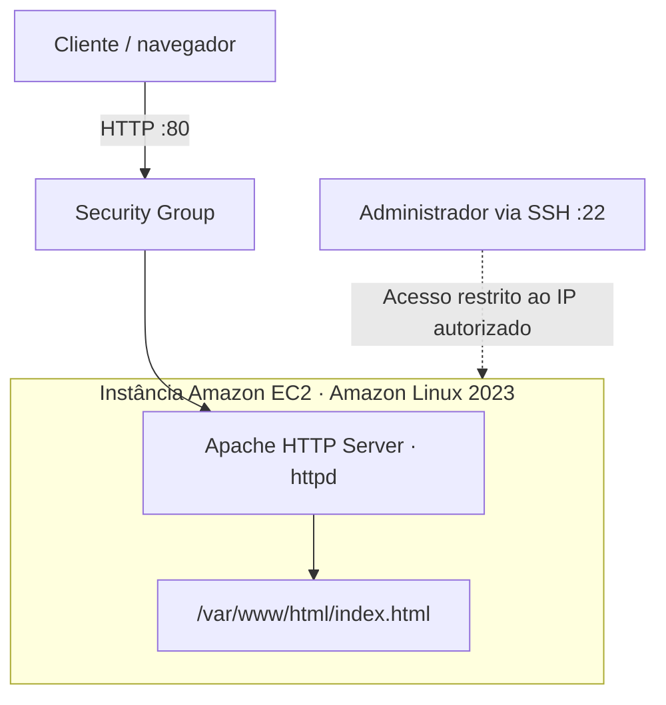
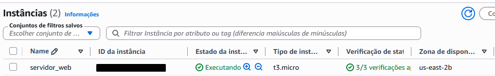
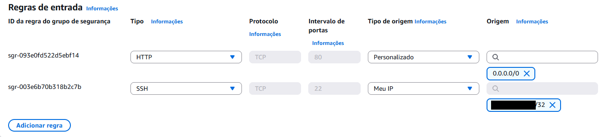
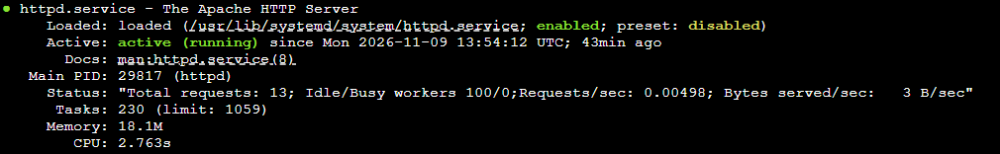
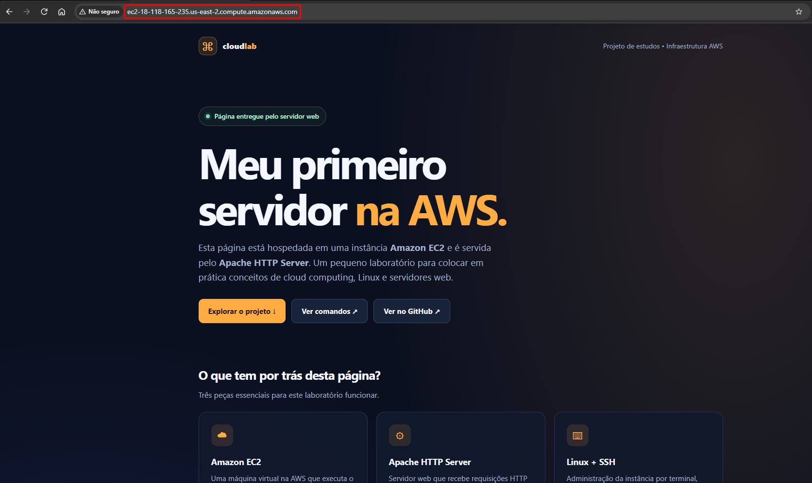

# CloudLab | AWS EC2 + Apache HTTP Server

Laboratório prático de **computação em nuvem e administração Linux**, com o objetivo de hospedar uma página estática em uma instância **Amazon EC2**, utilizando o **Apache HTTP Server** para responder a requisições HTTP.

O foco deste projeto não está na complexidade do HTML, e sim no processo de **provisionamento, acesso remoto, configuração de rede, instalação de serviços e publicação na nuvem**.

## Tecnologias utilizadas

| Tecnologia | Papel no laboratório |
| --- | --- |
| Amazon EC2 (`t3.micro`) | Máquina virtual na AWS |
| Amazon Linux 2023 | Sistema operacional da instância |
| Apache HTTP Server (`httpd`) | Servidor web responsável por entregar o HTML |
| OpenSSH | Administração remota por terminal |
| AWS Security Groups | Controle de tráfego de entrada da instância |
| HTML e CSS | Conteúdo estático servido pelo Apache |

**Região utilizada:** `us-east-2` (Ohio).

## Arquitetura



O navegador acessa o **IPv4 público da instância**. O Security Group permite a conexão HTTP na porta 80. O Apache, executado dentro da EC2, responde entregando o conteúdo do arquivo `index.html`.

O SSH serve para administrar a máquina remotamente e **não participa da entrega da página aos visitantes**.

## Configuração e publicação

### 1. Provisionamento da instância

A instância é configurada no console do Amazon EC2 com Amazon Linux 2023 e um par de chaves SSH. Neste laboratório foi utilizada uma instância `t3.micro`.

Antes de disponibilizar o servidor, configure as regras de entrada do **Security Group**:

| Serviço | Porta | Origem | Motivo |
| --- | ---: | --- | --- |
| HTTP | `80/TCP` | `0.0.0.0/0` | Permitir o acesso público à página |
| SSH | `22/TCP` | `SEU_IP_PUBLICO/32` | Restringir a administração ao endereço autorizado |

**HTTPS (`443/TCP`) não é necessário neste laboratório**, porque não foi configurado um certificado TLS. Abrir essa porta, isoladamente, não habilita HTTPS.

### 2. Conexão SSH

No terminal local, utilizando a chave privada criada para a instância:

```bash
ssh -i "caminho/para/sua-chave.pem" ec2-user@IP_PUBLICO_DA_INSTANCIA
```

No Amazon Linux, o usuário padrão é `ec2-user`. O arquivo `.pem` é **privado** e não deve ser enviado ao repositório.

### 3. Instalação do Apache

Na instância EC2:

```bash
sudo dnf update -y
sudo dnf install -y httpd
sudo systemctl enable --now httpd
sudo systemctl status httpd --no-pager
```

`enable --now` configura o serviço para iniciar com o sistema e também o inicia imediatamente.

### 4. Publicação do HTML

O Apache serve arquivos estáticos, por padrão, a partir de `/var/www/html/`.

A partir do terminal local, envie o HTML para a pasta pessoal do usuário remoto:

```bash
scp -i "caminho/para/sua-chave.pem" index.html ec2-user@IP_PUBLICO_DA_INSTANCIA:~/index.html
```

Em seguida, conecte-se ao EC2 por SSH e publique o arquivo no diretório do servidor web:

```bash
sudo install -m 644 ~/index.html /var/www/html/index.html
```

O `install -m 644` copia o arquivo e define permissão de leitura para o Apache.

### 5. Verificação do serviço e da resposta HTTP

Execute no EC2:

```bash
sudo systemctl is-active httpd
curl -I http://localhost
ls -l /var/www/html/index.html
```

Resultados esperados:

- `systemctl is-active httpd`: `active`;
- `curl -I http://localhost`: resposta `HTTP/1.1 200 OK` (ou equivalente HTTP/1.0/2);
- `ls`: confirma a presença do HTML no diretório público.

Para verificar o acesso externo, abra `http://IP_PUBLICO_DA_INSTANCIA` no navegador. O resultado esperado é a página **CloudLab**.

## Evidências

As capturas abaixo registram as etapas do laboratório. Identificadores sensíveis, como o ID da instância e o IP de administração, foram ocultados.

### Instância EC2

Instância `t3.micro` em execução no console AWS, com as verificações de status aprovadas.



### Regras de entrada do Security Group

HTTP (`80`) liberado para acesso público e SSH (`22`) restrito ao IP do administrador.



### Apache ativo no Linux

Saída do comando `systemctl status httpd`, com o serviço `active (running)` e habilitado para iniciar com o sistema (`enabled`).



### Página publicada

Página CloudLab acessada pelo navegador através do endereço DNS público da instância EC2. O aviso **"Não seguro"** é esperado, pois o laboratório utiliza HTTP, sem certificado TLS.




## Segurança e limites do laboratório

- A porta **22 (SSH)** deve ficar restrita ao IP do administrador, e não aberta para `0.0.0.0/0`.
- A porta **80 (HTTP)** foi disponibilizada publicamente para servir a página.
- **Não foi configurado HTTPS/TLS**. O conteúdo é estático e não recebe credenciais ou dados sensíveis.
- O repositório não contém chaves privadas, tokens ou credenciais da AWS.
- Ao parar a instância, a página deixa de ficar disponível. O IP público também pode mudar após uma parada e posterior inicialização.
- A AWS pode cobrar por recursos associados à instância, como armazenamento EBS e endereços IPv4 públicos. O uso do Free Plan/créditos deve ser acompanhado no console de faturamento.

## Estrutura do projeto

```text
aws-ec2-apache-lab/
├── .gitignore
├── index.html
├── README.md
└── images/
    ├── instance.png
    ├── pagina-publicada.png
    ├── security.png
    └── status.png
```

## Aprendizados

Este laboratório permitiu praticar o ciclo básico de publicação de uma aplicação estática na nuvem: **criação de instância EC2, administração Linux por SSH, permissões de rede com Security Groups, instalação e execução do Apache e verificação de respostas HTTP**.

---

**Autor:** [Vinícius Gondaline Silva](https://github.com/Gondaline)  
**Finalidade:** laboratório de estudos em AWS e infraestrutura web.
